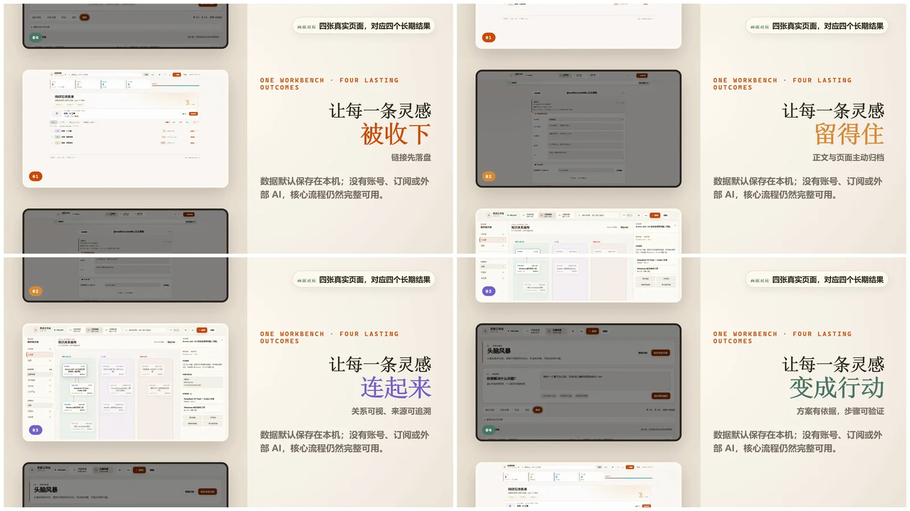
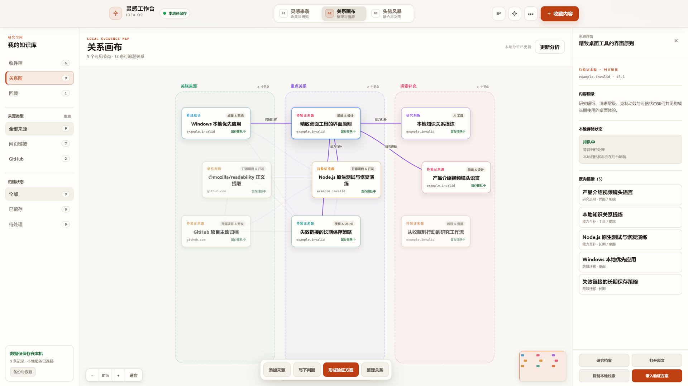
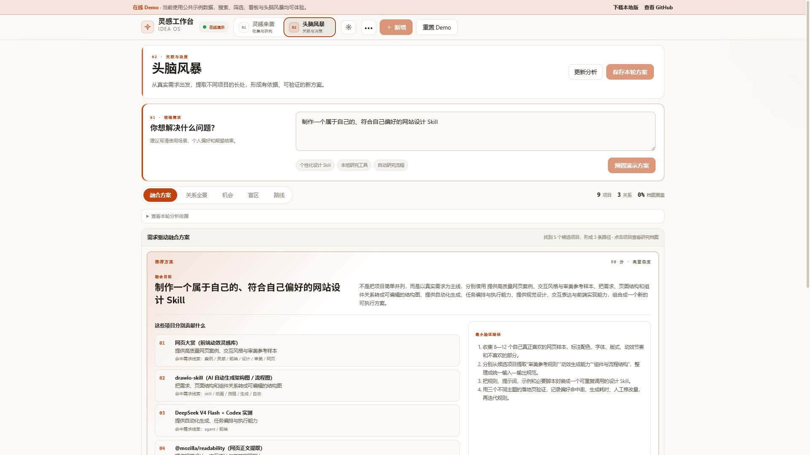

<p align="center">
  
</p>

<p align="center">
  <strong>把散落的链接变成可研究的项目库，再让不同项目的长处碰撞成新方案。</strong>
</p>

<p align="center">
  <a href="https://github.com/WYHCIPUC/TodoBoard/actions/workflows/ci.yml"></a>
  <a href="https://wyhcipuc.github.io/TodoBoard/?demo=1"></a>
  <a href="https://github.com/WYHCIPUC/TodoBoard/releases"></a>
  <a href="LICENSE"></a>
  
</p>

<p align="center">
  <a href="https://wyhcipuc.github.io/TodoBoard/?demo=1"><strong>在线体验</strong></a> ·
  <a href="https://github.com/WYHCIPUC/TodoBoard/releases"><strong>下载 Windows 版</strong></a> ·
  <a href="#快速开始">源码运行</a> ·
  <a href="#文档与开发">文档</a>
</p>

## 2 分钟看懂 v1.0 → v2.3

从 v1.0 的本地收藏，到 v2.3 的主动归档、移动收集、关系画布、头脑风暴与可信恢复：这支视频用真实产品画面，完整展示灵感如何被收下、留住、连接并变成行动。

<p align="center">
  <a href="https://github.com/WYHCIPUC/TodoBoard/releases/download/v2.3.0/linggan-project-overview-v1-v2.3-calm-expanded.mp4">
    
  </a>
</p>

<p align="center">
  <a href="https://github.com/WYHCIPUC/TodoBoard/releases/download/v2.3.0/linggan-project-overview-v1-v2.3-calm-expanded.mp4"><strong>▶ 观看完整介绍视频（2:01）</strong></a><br>
  <sub>Windows 桌面客户端 · 数据保存在本地 · 核心流程无需 API Key</sub>
</p>

## 三种模式，一个工作流

<p align="center">
  <strong>链接 / 想法</strong> → <strong>灵感来袭</strong> → <strong>关系画布</strong> → <strong>头脑风暴</strong> → <strong>方案 / MVP</strong><br>
  <sub>收集与研究 · 关联与溯源 · 融合与验证</sub>
</p>

### 01 · 灵感来袭

粘贴网页、GitHub 仓库或视频链接，系统会先保存 URL，再在后台补全标题、作者、摘要和分类，并主动归档可读正文、关键图片与压缩原始页面。随后可以在列表或看板中筛选、记录笔记，并把真正重要的内容推进到研究流程。

<p align="center">
  
</p>

### 02 · 关系画布

把本地项目按主题聚成可缩放、可拖拽的证据空间，查看来源之间的可追溯关系、归档状态和反向链接。筛选结果、节点位置和研究上下文都留在本机；分析接口不可用时会自动保留离线基础关系。

<p align="center">
  
</p>

### 03 · 头脑风暴

从一个真实需求出发，分析项目库中不同事项的能力、场景和关联依据，生成多条融合路径、候选项目贡献和最小验证步骤。结果可保存为本地 Markdown，成为可复盘的决策记录。

<p align="center">
  
</p>

<details>
<summary><strong>查看看板视图</strong></summary>
<br>
<p align="center">
  
</p>
</details>

> [在线 Demo](https://wyhcipuc.github.io/TodoBoard/?demo=1) 使用公共示例数据，可直接体验搜索、筛选、列表、看板、关系画布、统计与头脑风暴。演示站为只读模式，不会上传或保存个人数据。

## 为什么使用它

- **收集后还能继续生长**：不止保存书签，还能进入正文、笔记、截图、计时和研究状态。
- **链接失效前主动留档**：保存后立即在本机异步归档主要内容；来源删除或暂时不可访问时，已保存 URL 不会丢失。
- **建议有来源可追溯**：头脑风暴会说明候选项目贡献、关联信号与验证路径，不只给出几个泛泛结论。
- **数据始终属于你**：条目保存在可直接阅读、编辑和备份的 `DATA.md`，不依赖云端账号或专有数据库。
- **开始成本低**：普通用户下载 Windows 单文件即可运行；开发者可以直接使用 Node.js 源码。

## 快速开始

### Windows 一键启动

1. 公开下载：打开 [GitHub Releases](https://github.com/WYHCIPUC/TodoBoard/releases)，下载 `linggankanban-2.3.0-windows-portable-x64.zip`，解压后双击 `start-portable.bat`。
2. 人工购买：收到 `linggankanban-<版本>-windows-x64.exe` 后直接双击。新版单文件程序会打开独立桌面窗口；若 Microsoft Edge 不可用，则自动回退到默认浏览器兼容模式。

运行环境会缓存到 `%LOCALAPPDATA%\LingganKanban\app`，个人数据和备份独立保存在“文档\LingganKanban”。升级或替换 EXE 不会覆盖数据。

> 当前 Windows EXE 尚未购买代码签名证书。请只从卖家提供的可信地址获取，并使用 Release 中的 `SHA256SUMS.txt` 校验完整性。两种成品都不要求安装 Node.js。

### 使用源码

需要 Node.js 22 或更高版本（Node.js 20 已停止支持）：

```bash
git clone https://github.com/WYHCIPUC/TodoBoard.git
cd TodoBoard
npm ci
npm start
```

打开 [http://127.0.0.1:3865](http://127.0.0.1:3865)。首次运行会从 `DATA.example.md` 初始化本地数据；Windows 也可以双击 `start.bat`。

## 核心能力

| 能力 | 解决的问题 |
| --- | --- |
| 粘贴即解析 | 自动提取标题、作者、摘要、封面并给出分类建议 |
| 主动本地归档 | 保存后异步备份正文、元数据、关键图片和不超过 20 MB 的压缩原始 HTML |
| 列表 / 看板双视图 | 搜索、排序并按分类、状态筛选研究事项 |
| 完整研究档案 | 保存正文、独立笔记、截图、计时和进度 |
| 可交互关系画布 | 按主题整理本地来源，筛选、缩放、拖拽并追溯反向链接 |
| 需求驱动头脑风暴 | 从真实问题出发，提取项目长处，形成融合方案与 MVP |
| 知识关联 | 展示多维关系、跨分类碰撞、机会、挑战与行动路线 |
| 本地可靠存储 | 单一 Markdown 数据源、原子写入、自动备份和升级迁移 |
| 批量导入与重复治理 | 导入浏览器书签，合并标签或明确保留重复条目 |
| 远程收集 | 支持企业微信回调与钉钉 Stream 机器人转发入库 |

## 支持的内容

| 内容源 | 可提取信息 |
| --- | --- |
| GitHub 仓库 | README、作者、主要语言与 Star 数 |
| Bilibili 视频 | 标题、UP 主、封面与可用字幕 |
| 微信公众号 / 通用网页 | Open Graph、JSON-LD 与正文 |
| X / Twitter | 专用状态链接解析，可选使用仅存在于进程环境变量中的 `X_COOKIE`；失败时保留链接并支持人工补录 |
| YouTube、知乎等站点 | 通用页面解析；失败时从 URL 降级识别并保留链接 |

## 本地优先与安全

- 服务默认只监听 `127.0.0.1`，不应直接暴露到不受信任网络。
- 数据 API 需要本机会话 Cookie 或 `LINGGAN_API_TOKEN`。
- 抓取失败时仍会保存链接和可识别信息，避免灵感丢失。
- 归档任务保存在带恢复副本的本地队列，服务重启后继续处理；自动重试耗尽时可以手动重试或粘贴正文。
- 旧数据格式迁移前会先备份 `DATA.md` 和研究档案；已有数据首次按当前 migration contract 启动时会创建升级前完整快照，数据文件缺失但仍有档案时启动会拒绝继续。
- 服务启动后持有全数据卷级锁；`recover.js`、`upgrade-snapshot.js` 等恢复工具会拒绝与运行中的服务并发操作，恢复前请先停止服务。
- 同一数据目录已有实例时，新进程会启动只读看板（写接口返回 503）；关闭旧实例后重启即可恢复写入。
- 恢复默认只做检查和预览；候选不明确时停止，只有显式选择并确认后才写入，写入后生成可验证收据。
- 不要提交 `DATA.md`、自动备份、代理凭据或隧道密钥。

恢复检查不会修改数据：

```powershell
node scripts/recover.js --help
node scripts/recover.js --json
```

执行恢复前请停止其他实例，先复制整个数据目录，并按命令输出显式指定事务、候选与确认选项。详细步骤见 [v2.3.0 发布说明](docs/releases/v2.3.0.md)。

完整边界和漏洞报告方式见 [安全策略](SECURITY.md)。

## 文档与开发

- [项目原则](docs/PROJECT-PRINCIPLES.md) — 产品边界、决策优先级与质量底线
- [原则对照与补强计划](docs/plans/2026-08-14-principles-gap-analysis.md) — 当前优势、缺口和后续实施顺序
- [v2.2.0 可信恢复与回顾升级计划](docs/plans/2026-08-14-v2.2-trusted-recovery-review-plan.md) — 可信恢复基础的范围、任务依赖、失败回滚与发布门禁
- [文档索引](docs/INDEX.md) — 使用、设计、可靠性与发布资料入口
- [Windows 使用指南](docs/WINDOWS-GUIDE.md) — 安装、升级、改端口、故障排查与卸载
- [企业微信接入指南](docs/WECOM-GUIDE.md) — 转发链接远程入库
- [可靠链接归档说明](docs/plans/reliable-link-archive.md) — 主动备份、重试状态、X Cookie 与发布边界
- [钉钉接入指南](docs/DINGTALK-GUIDE.md) — Stream 模式，零域名零公网
- [更新日志](CHANGELOG.md) — 版本变化
- [v2.3.0 发布说明](docs/releases/v2.3.0.md) — 三阶段工作流、兼容性、升级、恢复、回滚与校验
- [v2.3 更新视频设计](docs/video/linggan-v2.3-update-design.md) — 新版功能映射、镜头节奏与数据边界
- [贡献指南](CONTRIBUTING.md) — 开发流程与提交规范
- [发布清单](docs/RELEASE-CHECKLIST.md) — 发布前检查
- [便携运行时说明](docs/PORTABLE-RUNTIME.md) — 内置 Node.js 的来源、校验与更新策略

<details>
<summary><strong>环境变量</strong></summary>

| 变量 | 默认值 | 用途 |
| --- | --- | --- |
| `PORT` | `3865` | 本地服务端口 |
| `HOST` | `127.0.0.1` | 监听地址 |
| `LINGGAN_API_TOKEN` | 自动生成 | 可选固定 API 令牌 |
| `README_FILE` | `./DATA.md` | 数据文件路径 |
| `NO_OPEN` | — | 设为 `1` 时不自动打开浏览器 |
| `LINGGAN_NO_OPEN` | — | 设为 `1` 时单文件启动器只启动服务，不打开桌面窗口（用于自动验收） |
| `PROXY_URL` | — | 显式代理地址 |
| `X_COOKIE` | — | 可选，仅向 `x.com` / `twitter.com` 请求发送；不要写入脚本、日志或仓库 |
| `ALLOW_PRIVATE_NETWORK` | — | 设为 `1` 允许抓取内网地址，不推荐 |
| `API_RATE_LIMIT` | `300` | 单客户端每分钟数据 API 请求上限 |
| `EXPENSIVE_RATE_LIMIT` | `30` | 单客户端每分钟抓取类请求上限 |
| `REMOTE_RATE_LIMIT` | `30` | 钉钉等消息入口每分钟远程采集上限 |
| `READ_ONLY_PORT` | — | 实例锁冲突时只读看板的指定端口；不设置则尝试原端口及后续端口 |
| `RATE_WINDOW_MS` | `60000` | 限流统计窗口，单位毫秒 |
| `AUDIT_LOG_FILE` | 数据目录下 `.linggan/audit.log` | 操作审计日志 |
| `SERVER_ERROR_LOG_FILE` | 数据目录下 `.linggan/server-error.log` | 服务异常日志 |
| `BRAINSTORM_DIR` | 数据目录下 `.linggan/brainstorms/` | 头脑风暴方案目录 |

</details>

<details>
<summary><strong>项目结构与检查命令</strong></summary>

```text
server.js             HTTP 路由与服务编排
launcher/             Windows 单文件桌面启动器
lib/                  抓取、分类、存储、知识关联和研究档案模块
lib/scraper/          GitHub、Bilibili 与网页正文解析
board.html/css/js     无框架浏览器客户端
DATA.example.md       首次运行的数据模板
docs/plans/           需求、设计与实施计划
```

```bash
npm test        # 单元测试
npm run check   # 语法检查 + 标准测试套件
```

</details>

## License

[MIT](LICENSE) · 欢迎通过 [贡献指南](CONTRIBUTING.md) 提交改进。
