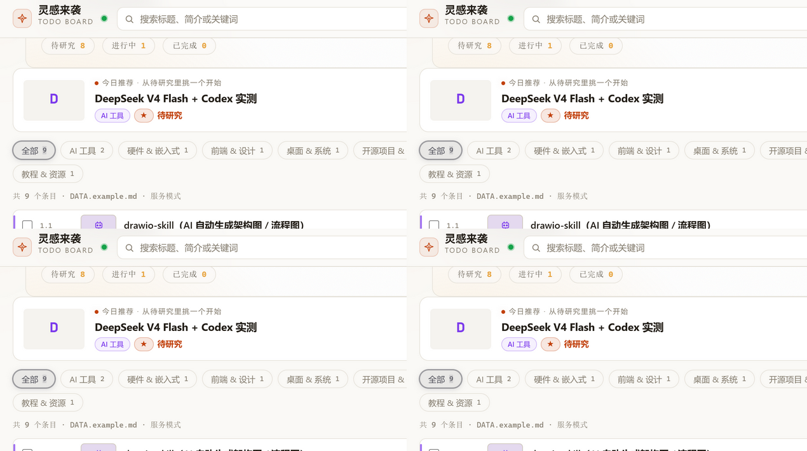
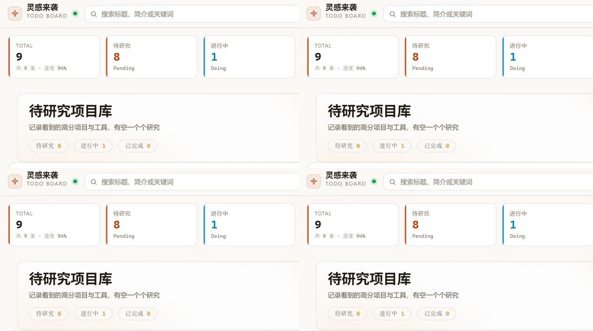

<div align="center">

# 💡 灵感来袭 · 待办看板

**本地优先的灵感 / 项目收集工具**

粘贴链接 → 自动解析标题、作者、简介 → 智能分类 → 研究笔记 → 一份 Markdown 搞定全部


[功能特性](#-功能特性) · [快速开始](#-快速开始) · [截图](#-截图) · [文档](#-文档)

</div>

---

> 看到一个有意思的项目/工具/文章，复制链接，粘贴进看板——它自动抓取标题、作者、摘要、封面并分类归档。需要深入研究时，一键抓取正文、记笔记、计时。**所有数据就是本地一份 `DATA.md`，不上传任何服务器。**

## ✨ 功能特性

| | 特性 | 说明 |
|---|---|---|
| 🔗 | **粘贴即解析** | B站 / GitHub / 微信公众号 / X / 知乎 / YouTube 等任意链接，自动抓取标题、作者、摘要并分类 |
| 🛡️ | **被墙也能用** | 自动探测本地代理（Clash/v2rayN）；抓取失败时智能兜底，**任何链接都能入库** |
| 📰 | **正文抓取** | 一键抓取文章正文 / GitHub README / B站字幕，转 Markdown 存档 |
| 📝 | **研究档案** | 每条目独立笔记（自动写回）、截图上传、番茄钟计时 |
| 🎨 | **双视图看板** | 列表 / 看板双视图，8 类智能分类，难度/状态标记，搜索排序 |
| 🔒 | **本地优先** | 数据就是一份 Markdown，浏览器自动备份，**零上传** |
| ⚡ | **零配置** | `npm install && npm start` 即用 |

## 🚀 快速开始

```bash
git clone https://github.com/WYHCIPUC/TodoBoard.git
cd TodoBoard
npm install
npm start
```

打开 **http://127.0.0.1:3865** 即可。首次运行自动从 `DATA.example.md` 初始化数据文件。

> Windows 用户也可直接双击 `start.bat`。要求 Node.js ≥ 20。

## 📸 截图

**列表视图**（点击展开详情面板，含研究/原文/状态/复制操作）：



**看板视图**（分类卡片，SVG 图标，状态徽章）：



## 🔗 链接解析支持

| 平台 | 解析方式 |
|---|---|
| **GitHub 仓库** | 官方 API（star 数、作者、语言） |
| **B站视频** | 官方 API（标题、UP 主、封面）+ 字幕抓取 |
| **微信公众号 / 通用网页** | og 标签 + JSON-LD + 正文提取（cheerio + readability） |
| **X(Twitter) / 被墙站点** | 代理抓取，失败时 URL 智能兜底解析 |

## 📖 文档

| 文档 | 内容 |
|---|---|
| [安全策略](SECURITY.md) | 本地服务安全模型、SSRF/CSRF 防护、报告渠道 |
| [贡献指南](CONTRIBUTING.md) | 开发流程、项目结构、提交规范 |
| [更新日志](CHANGELOG.md) | 版本历史与变更 |
| [行为准则](CODE_OF_CONDUCT.md) | 社区公约 |
| [发布清单](docs/RELEASE-CHECKLIST.md) | 发布到 GitHub 的操作步骤 |

## ⚙️ 环境变量

| 变量 | 默认 | 说明 |
|---|---|---|
| `PORT` | `3865` | 服务端口 |
| `HOST` | `127.0.0.1` | 监听地址（`0.0.0.0` 暴露局域网，**无认证**） |
| `README_FILE` | `./DATA.md` | 数据文件路径 |
| `NO_OPEN` | — | 设为 `1` 不自动打开浏览器 |
| `PROXY_URL` | — | 显式代理（如 `http://127.0.0.1:7890`） |
| `ALLOW_PRIVATE_NETWORK` | — | 设为 `1` 允许抓取内网（不推荐） |

## 🏗 项目结构

```
├─ server.js           # HTTP 路由编排
├─ lib/                # 业务模块
│  ├─ fetcher.js       #   链接元数据抓取 + 兜底解析 + 代理
│  ├─ scraper/         #   正文 / 字幕 / README 抓取
│  ├─ store.js         #   数据读写（原子写 + 备份）
│  ├─ entries.js       #   研究档案
│  ├─ classifier.js    #   分类
│  └─ safeurl.js       #   SSRF 校验
├─ board.html/css/js   # 前端（无框架）
├─ DATA.example.md     # 示例数据（首次运行初始化模板）
├─ guard.js            # 服务守护（崩溃自动拉起）
└─ docs/plans/         # 需求与设计文档
```

## 🔌 API

| 方法 | 路径 | 说明 |
|---|---|---|
| GET | `/api/data` | 读取数据文件 |
| GET | `/api/fetch-meta?url=` | 抓取链接元数据 |
| POST | `/api/add` | 新增条目 |
| POST | `/api/delete` `/status` `/note` | 删除 / 状态 / 笔记 |
| POST | `/api/entry/*` | 研究档案（笔记 / 截图 / 抓正文） |

## 🛠 开发

```bash
npm test        # 单元测试
npm run check   # 语法检查 + 全部测试
```

## 📜 License

[MIT](LICENSE) · 欢迎贡献，详见 [贡献指南](CONTRIBUTING.md)

---

<div align="center">

如果这个项目对你有帮助，欢迎 ⭐ Star 支持！

</div>
