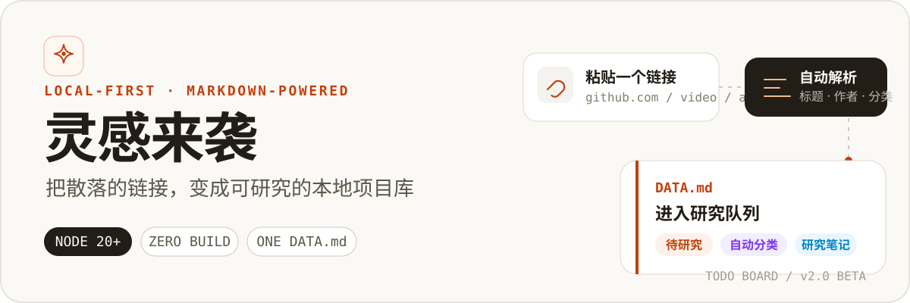
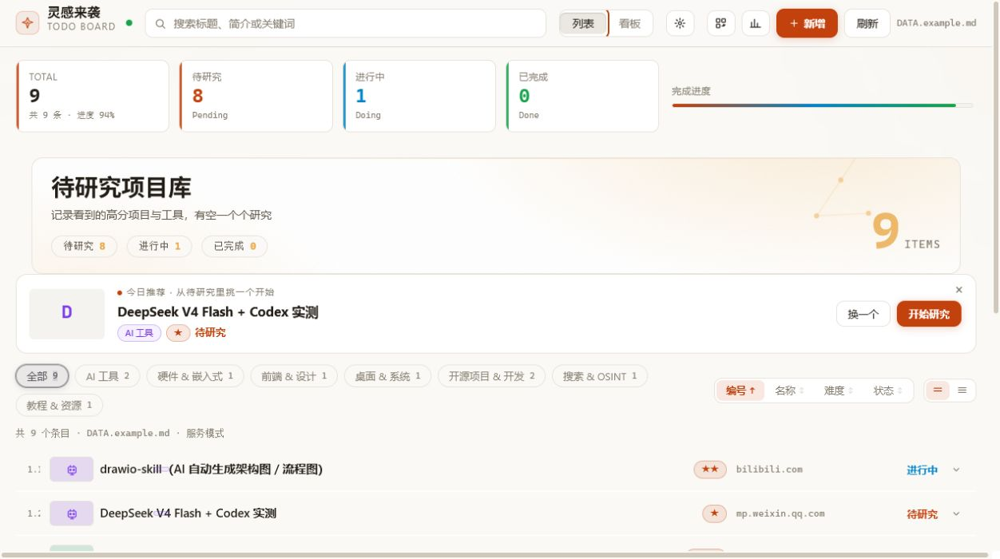
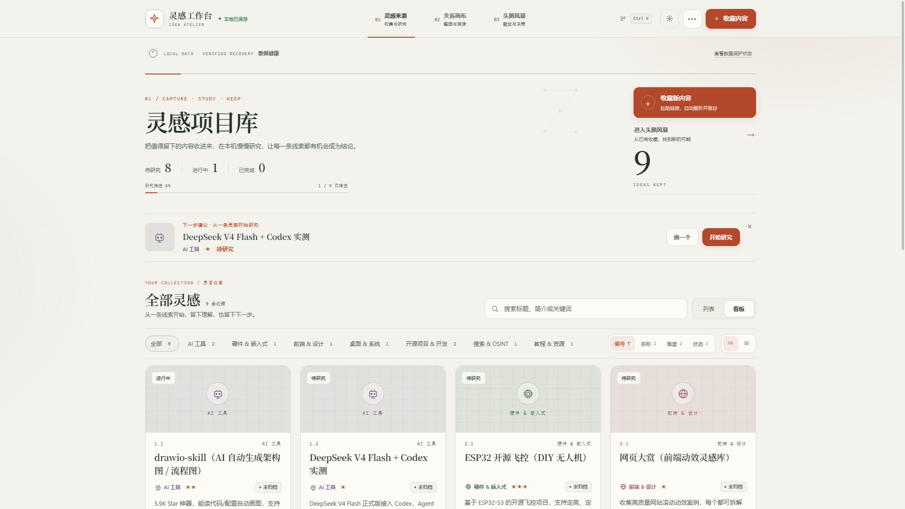

<p align="center">
  
</p>

<p align="center">
  <strong>粘贴链接，自动归档；需要深入时，再把收藏变成研究。</strong>
</p>

<p align="center">
  <a href="https://github.com/WYHCIPUC/TodoBoard/actions/workflows/ci.yml"></a>
  <a href="LICENSE"></a>
  
  
</p>

<p align="center">
  <a href="#快速开始">快速开始</a> ·
  <a href="#它如何工作">工作方式</a> ·
  <a href="#支持的内容">解析支持</a> ·
  <a href="#配置与文档">配置与文档</a>
</p>

## 先看实际效果

数据不是锁在数据库里，而是始终保存在你能直接阅读、编辑和备份的 `DATA.md` 中。看板只负责让收集、筛选和研究更顺手。

<p align="center">
  
</p>
<p align="center"><sub>列表视图：快速筛选、排序并展开研究详情</sub></p>

<details>
<summary><strong>查看看板视图</strong></summary>
<br>
<p align="center">
  
</p>
</details>

## 它如何工作

1. **粘贴或转发链接**：支持网页、仓库、视频等常见内容源。
2. **自动补全信息**：抓取标题、作者、摘要和封面，并给出分类建议。
3. **落盘到 Markdown**：条目写入本地 `DATA.md`，同时保留自动备份。
4. **进入研究流程**：切换状态、抓取正文、记录笔记、上传截图或启动番茄钟。
5. **头脑风暴工作台**：与灵感收集同级；先输入一个真实需求，再从全部收藏中提取不同项目的长处，形成有依据的融合方案和最小验证步骤，同时保留全景关系、机会、挑战与行动路线。

这套流程没有云端账号，也不要求数据库。抓取失败时仍会保留链接和可识别信息，避免灵感丢失。

## 核心能力

| 能力 | 具体作用 |
| --- | --- |
| 粘贴即解析 | 自动提取元数据并归入 8 类项目库 |
| 列表 / 看板双视图 | 搜索、排序、按分类或状态筛选 |
| 研究档案 | 正文存档、独立笔记、截图和计时 |
| 头脑风暴 | 独立一级工作台；以真实需求为起点，解释候选项目贡献，生成多条融合路径和 MVP；同时展示多维关系，并可把本轮方案保存为本地 Markdown 持续复盘 |
| 本地优先 | 单一 Markdown 数据源、原子写入和自动备份 |
| 低成本迁移 | Chrome、Edge 等浏览器书签可预检后批量导入，原文件夹自动保留为标签 |
| 重复治理 | 重复链接可打开已有条目、合并标签与收藏原因，或明确保留副本 |
| 数据可控 | 首次使用引导、完整备份恢复和数据健康诊断集中在界面内完成 |
| 网络兜底 | 自动探测常见本地代理，并对失败链接降级保存 |
| 企业微信收集 | 把链接转发给自建应用即可远程入库 |
| 钉钉收集 | Stream 模式接入，**零域名零公网**，给机器人发链接即入库（[教程](docs/DINGTALK-GUIDE.md)） |

## 快速开始

普通用户推荐下载 Windows 单文件版；双击即可启动，无需安装 Node.js，也无需解压。

### Windows 快速开始

1. 从 [GitHub Releases](https://github.com/WYHCIPUC/TodoBoard/releases) 下载 `linggankanban-2.0.0-beta.2-windows-x64.exe`。
2. 双击该文件。首次启动会显示准备进度，完成后自动打开浏览器。

程序与内置运行时会缓存到 `%LOCALAPPDATA%\LingganKanban\app`；收藏、研究档案和备份独立保存在“文档\LingganKanban”，替换或升级 EXE 不会覆盖这些数据。

单文件版内置经官方 SHA-256 校验的 Node.js 22.23.2 x64 运行时和锁定依赖；启动器会检查数据目录权限和端口占用。如果看板已经运行，则直接打开浏览器。当前 Beta 尚未购买代码签名证书；请只从本仓库 Release 下载，并用发行页提供的 SHA-256 校验文件核对完整性。需要免安装压缩包时，仍可选择 `windows-portable-x64.zip`。

开发者或需要自定义运行时的用户可以使用源码包：

```bash
git clone https://github.com/WYHCIPUC/TodoBoard.git
cd TodoBoard
npm ci
npm start
```

打开 [http://127.0.0.1:3865](http://127.0.0.1:3865)。首次运行会从 `DATA.example.md` 初始化本地数据；源码包在 Windows 上也可以双击 `start.bat`。

从旧版本升级时，程序会先把 `DATA.md` 和研究档案完整备份到 `.linggan/migration-backups/`，再为条目补充稳定标识并升级数据格式。迁移失败不会覆盖源数据。

Windows 的升级、数据迁移、改端口和卸载步骤见 [Windows 使用指南](docs/WINDOWS-GUIDE.md)。

## 支持的内容

| 内容源 | 解析内容 |
| --- | --- |
| GitHub 仓库 | README、作者、主要语言与 Star 数 |
| Bilibili 视频 | 标题、UP 主、封面与可用字幕 |
| 微信公众号 / 通用网页 | Open Graph、JSON-LD 与正文 |
| X、YouTube、知乎等站点 | 代理抓取；失败时从 URL 降级识别 |

企业微信转发入库的配置步骤见 [企业微信接入指南](docs/WECOM-GUIDE.md)。

## 配置与文档

<details>
<summary><strong>环境变量</strong></summary>

| 变量 | 默认值 | 用途 |
| --- | --- | --- |
| `PORT` | `3865` | 本地服务端口 |
| `HOST` | `127.0.0.1` | 监听地址；非本机访问默认无法获得浏览器会话 |
| `LINGGAN_API_TOKEN` | 自动生成 | 可选的固定 API 访问令牌，供受控的高级接入使用 |
| `README_FILE` | `./DATA.md` | 数据文件路径 |
| `NO_OPEN` | — | 设为 `1` 时不自动打开浏览器 |
| `PROXY_URL` | — | 显式代理，例如 `http://127.0.0.1:7890` |
| `ALLOW_PRIVATE_NETWORK` | — | 设为 `1` 允许抓取内网地址，不推荐 |
| `API_RATE_LIMIT` | `300` | 单个客户端每分钟数据 API 请求上限 |
| `EXPENSIVE_RATE_LIMIT` | `30` | 单个客户端每分钟抓取类请求上限 |
| `RATE_WINDOW_MS` | `60000` | 限流统计窗口，单位毫秒 |
| `AUDIT_LOG_FILE` | 数据目录下 `.linggan/audit.log` | 操作审计日志；不记录正文、链接或请求体 |
| `SERVER_ERROR_LOG_FILE` | 数据目录下 `.linggan/server-error.log` | 服务异常日志；升级程序时继续保留 |
| `BRAINSTORM_DIR` | 数据目录下 `.linggan/brainstorms/` | 已保存头脑风暴方案的 Markdown 目录 |

</details>

- [安全策略](SECURITY.md) — 本地服务边界、SSRF / CSRF 防护与漏洞报告
- [贡献指南](CONTRIBUTING.md) — 开发流程、代码结构与提交规范
- [更新日志](CHANGELOG.md) — 版本变化
- [发布清单](docs/RELEASE-CHECKLIST.md) — 发布前检查
- [Windows 使用指南](docs/WINDOWS-GUIDE.md) — 安装、升级、故障排查与卸载
- [便携运行时说明](docs/PORTABLE-RUNTIME.md) — 内置 Node.js 的来源、校验与更新策略

<details>
<summary><strong>项目结构与开发命令</strong></summary>

```text
server.js             HTTP 路由与服务编排
lib/                  抓取、分类、存储、知识图谱和研究档案模块
lib/scraper/          GitHub、Bilibili 与网页正文解析
board.html/css/js     无框架浏览器客户端
DATA.example.md       首次运行的数据模板
docs/plans/           需求、设计与实施计划
```

```bash
npm test        # 运行单元测试
npm run check   # 语法检查 + 标准测试套件
```

</details>

## 安全说明

服务默认只监听 `127.0.0.1`。数据 API 需要本机会话 Cookie 或 `LINGGAN_API_TOKEN`；企业微信回调使用平台签名校验，并且只具有新增链接能力。即便如此，也不要把本地端口直接暴露到不受信任网络。请阅读 [SECURITY.md](SECURITY.md)，并且不要提交 `DATA.md`、自动备份、代理凭据或隧道密钥。

## License

[MIT](LICENSE) · 欢迎通过 [贡献指南](CONTRIBUTING.md) 提交改进。
